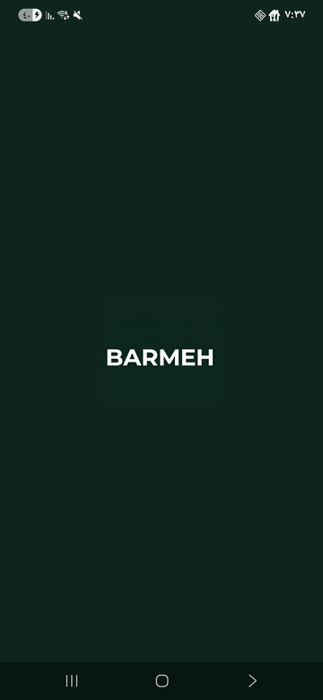
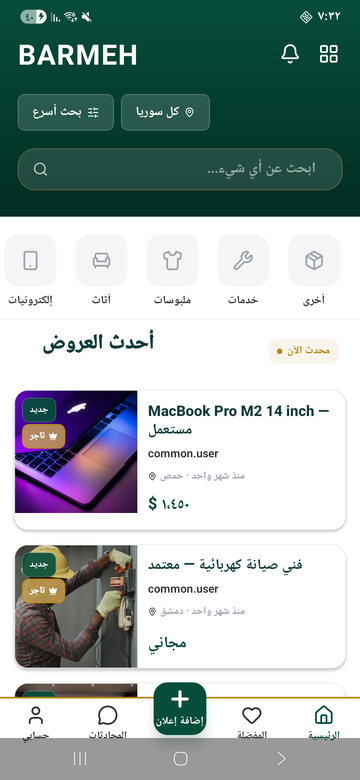
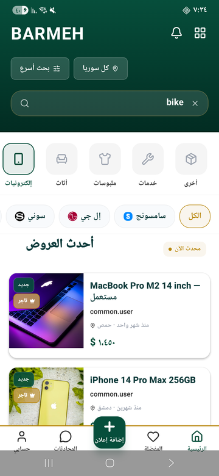
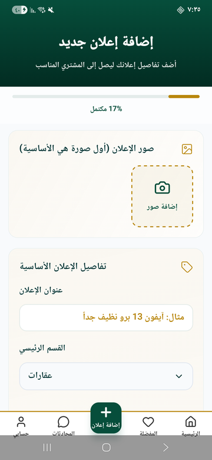
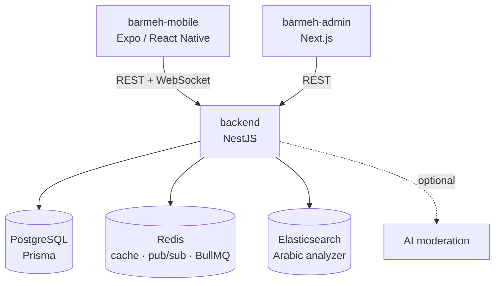

<div align="center">

# Barmeh · برمة

**An open-source, Arabic-first classifieds marketplace — mobile app, API and admin panel in one repo.**

Build your own OLX / Dubizzle-style local marketplace: listings, categories with dynamic attributes, real-time chat, bookings, search, moderation and an admin dashboard.

[](LICENSE)
[](CONTRIBUTING.md)


[العربية](#بالعربي) · [Features](#features) · [Quick start](#quick-start) · [Architecture](#architecture) · [Roadmap](#roadmap)

&nbsp;
&nbsp;
&nbsp;


</div>

---

## Why this exists

Most open-source marketplace starters are English-only web templates. Barmeh was built as a real product for an Arabic-speaking market, then opened up. It handles the things that usually get skipped:

- **RTL from day one** — Arabic is the default language, English is a toggle, layouts flip correctly.
- **Arabic search** — Elasticsearch with an Arabic analyzer (normalization + stemming), with automatic PostgreSQL fallback when ES is down.
- **Moderation built in** — forbidden-keyword lists, duplicate-image detection (perceptual hash), velocity checks, shadow bans, and optional AI review of text and images.
- **A full stack, not a UI kit** — the API, the mobile app and the admin panel all work together out of the box.

## Features

**Mobile app (Expo / React Native)**
- Browse, search and filter listings; category carousel with brand chips
- Multi-step "post an ad" wizard with photo upload and per-category dynamic fields (cars, real estate, electronics…)
- Real-time 1:1 chat (Socket.IO), archive and delete messages
- Bookings: request, accept, reject and cancel reservations on a listing
- Favorites, public seller profiles, trust badges, map view
- Google sign-in, push notifications, Arabic/English with RTL
- In-app "force update" gate driven by the API

**API (NestJS)**
- JWT access + refresh tokens with rotation and session revocation
- Listings, categories (tree), dynamic attributes, images (Sharp → WebP thumbnails)
- Search via Elasticsearch with Postgres fallback, cursor pagination
- Chat gateway with Redis adapter (horizontal scaling ready)
- Reports, moderation queue, abuse scoring, account deletion with anonymization
- Background jobs with BullMQ, OpenAPI docs, health checks, Sentry and OpenTelemetry hooks

**Admin panel (Next.js)**
- Dashboard stats, users, listings, categories, moderation queue, broadcast notifications

## Tech stack

| Layer | Stack |
|---|---|
| Mobile | Expo, React Native, Expo Router, NativeWind, i18next |
| API | NestJS, Prisma, PostgreSQL, Redis, BullMQ, Socket.IO, Elasticsearch |
| Admin | Next.js (App Router), Tailwind CSS |
| Ops | Docker Compose, Prometheus, Grafana, GitHub Actions |

## Quick start

Requirements: Node.js 20+, Docker.

```bash
git clone https://github.com/Eiadaljazairli/barmeh-oss.git
cd barmeh-oss

# 1. Infrastructure: Postgres, Redis, Elasticsearch
cp .env.example .env
docker compose up -d postgres redis elasticsearch

# 2. API → http://localhost:3000  (Swagger at /docs)
cd backend
cp .env.example .env        # fill in JWT_SECRET and ENCRYPTION_KEY
npm install
npx prisma migrate deploy
npm run build && npx prisma db seed
npm run start:dev

# 3. Admin panel → http://localhost:3001
cd ../barmeh-admin
npm install
NEXT_PUBLIC_API_URL=http://localhost:3000/v1 npm run dev -- -p 3001

# 4. Mobile app
cd ../barmeh-mobile
npm install
npx expo start
```

On a physical phone, set `expo.extra.apiUrl` in `barmeh-mobile/app.json` to your computer's LAN address (for example `http://192.168.1.10:3000/v1`).

### Optional services

Everything below is optional; the app runs without it.

| Feature | Configure |
|---|---|
| Google sign-in | `GOOGLE_CLIENT_ID_WEB/ANDROID/IOS` in the API, matching IDs in `app.json` |
| Push notifications (Android) | add your own `google-services.json` and set `android.googleServicesFile` |
| AI moderation | `GEMINI_API_KEY` |
| Email OTP | `SMTP_*` |
| Admin alerts | `TELEGRAM_BOT_TOKEN`, `TELEGRAM_ADMIN_CHAT_ID` |
| Error tracking | `SENTRY_DSN` |

## Architecture



```
.
├── backend/          NestJS API (Prisma schema, migrations, seed, tests)
├── barmeh-mobile/    Expo app (expo-router screens in app/, components/, i18n/)
├── barmeh-admin/     Next.js admin dashboard
├── monitoring/       Prometheus config
├── docs/             Architecture notes and screenshots
└── docker-compose.yml
```

More detail: [ARCHITECTURE.md](ARCHITECTURE.md).

## Roadmap

- [ ] One-command `docker compose up` for the whole stack including the API
- [ ] Seed data with sample images
- [ ] Payments / promoted listings provider abstraction
- [ ] Web client for buyers
- [ ] More languages (French, Turkish, Kurdish)

Ideas and PRs welcome — see [CONTRIBUTING.md](CONTRIBUTING.md).

## بالعربي

**برمة** سوق إعلانات مبوبة مفتوح المصدر، مبني بالعربي أولاً: تطبيق موبايل (Expo) + سيرفر (NestJS) + لوحة تحكم (Next.js).
فيه نشر إعلانات بحقول حسب القسم، بحث عربي ذكي، محادثات فورية، حجوزات، مراجعة ومنع محتوى مخالف، ولوحة إدارة كاملة.
خده، شغّله، وعدّل عليه لتبني سوقك المحلي — والرخصة MIT يعني بتقدر تستخدمه حتى تجارياً.

إذا عجبك المشروع، حط ⭐ — بتفرق كتير.

## Contributing

Bug reports, translations and pull requests are welcome. Read [CONTRIBUTING.md](CONTRIBUTING.md) first; report security issues privately as described in [SECURITY.md](SECURITY.md).

## License

[MIT](LICENSE)
